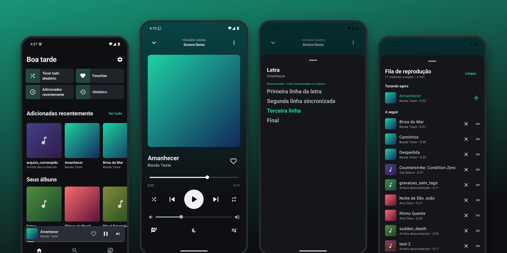
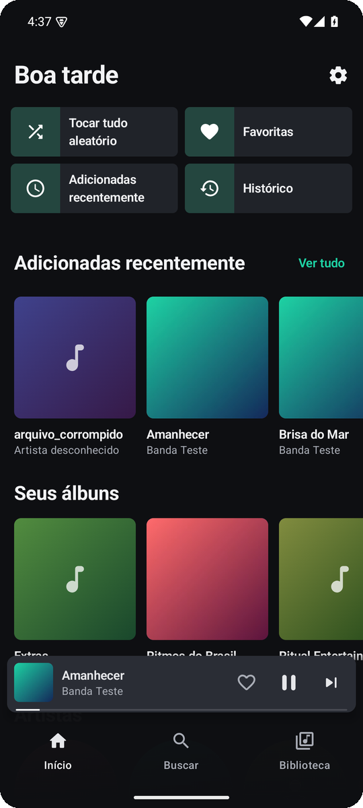
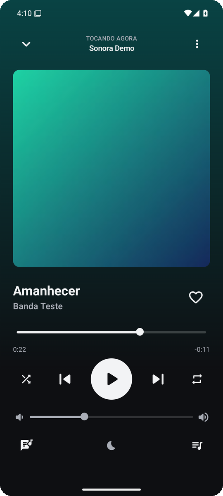
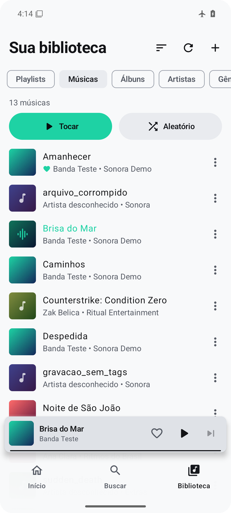
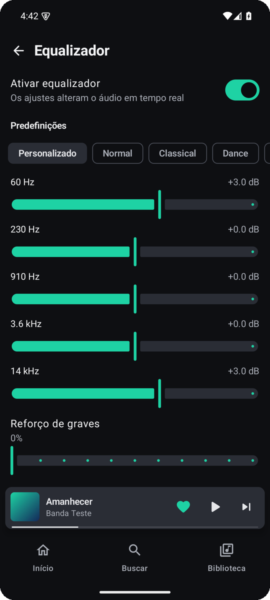
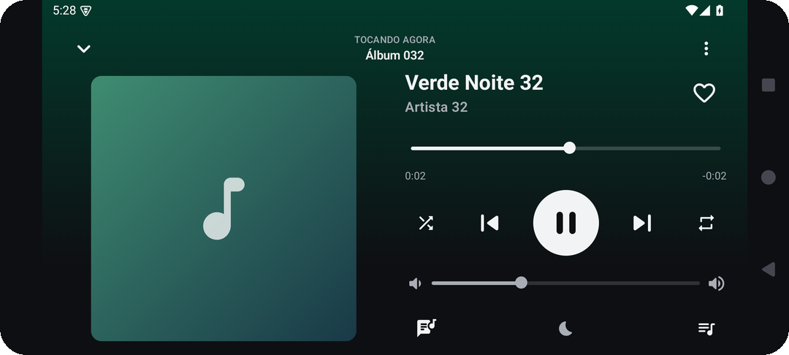
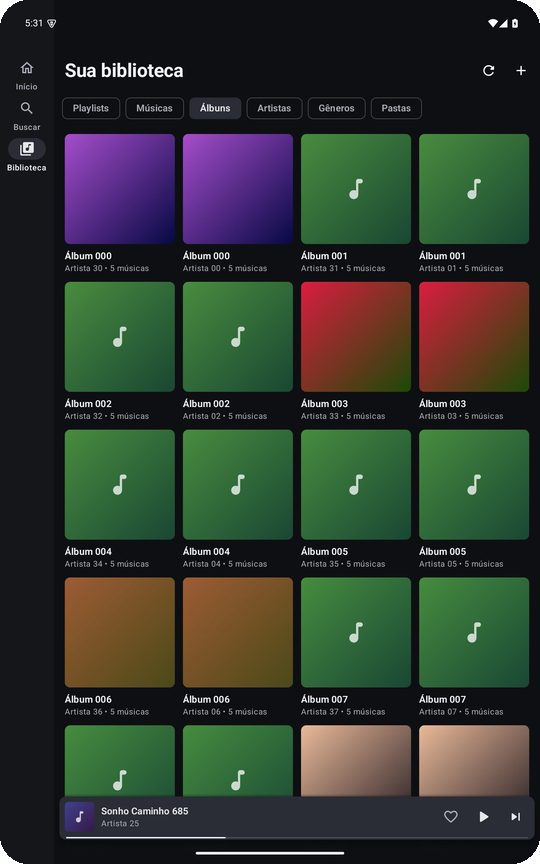

<p align="center">
  
</p>

<h1 align="center">Sonora</h1>

<p align="center">
  <b>Suas músicas, do seu jeito — direto do celular.</b><br>
  Reprodutor de música offline para Android. Sem internet, sem conta, sem anúncios.
</p>

<p align="center">
  <a href="https://github.com/diegonogueira4567-star/sonora/releases/latest"></a>
  
  <a href="https://github.com/diegonogueira4567-star/sonora/releases"></a>
  
  <a href="LICENSE"></a>
</p>

<p align="center">
  <a href="https://github.com/diegonogueira4567-star/sonora/releases/latest/download/Sonora.apk">
    
  </a>
</p>

<p align="center">
  
</p>

---

## ✨ O que ele faz

<table>
  <tr>
    <td width="50%" valign="top">
      <h3>🎵 Sua biblioteca, organizada</h3>
      Encontra sozinho as músicas do aparelho e organiza por álbuns, artistas, gêneros e pastas.
      Também lê pastas que você escolher, inclusive no cartão SD.
    </td>
    <td width="50%" valign="top">
      <h3>▶️ Reprodução que não para</h3>
      Continua tocando com a tela desligada ou em outro app, com controles na notificação,
      na tela de bloqueio e nos fones Bluetooth.
    </td>
  </tr>
  <tr>
    <td valign="top">
      <h3>📝 Playlists, favoritas e fila</h3>
      Crie e reordene playlists arrastando, marque favoritas, monte a fila com “tocar a seguir”
      e veja o que você mais ouviu.
    </td>
    <td valign="top">
      <h3>🔎 Busca instantânea</h3>
      Ache músicas, artistas, álbuns e playlists enquanto digita — sem acento, sem maiúscula,
      sem internet.
    </td>
  </tr>
  <tr>
    <td valign="top">
      <h3>🎚️ Som do seu jeito</h3>
      Equalizador do aparelho com predefinições, reforço de graves, transição suave entre faixas
      e temporizador para dormir.
    </td>
    <td valign="top">
      <h3>🎤 Letras sincronizadas</h3>
      Mostra a letra gravada no arquivo e destaca a linha que está tocando (formato LRC).
    </td>
  </tr>
  <tr>
    <td valign="top">
      <h3>🌗 Tema claro e escuro</h3>
      Tema escuro por padrão, tema claro, cores do papel de parede (Android 12+) e sete cores
      de destaque.
    </td>
    <td valign="top">
      <h3>📱 Qualquer tela</h3>
      Se adapta a celulares compactos, celular deitado, tablets e fontes ampliadas.
    </td>
  </tr>
</table>

## 📲 Como instalar

1. No celular, toque em **[Baixar Sonora.apk](https://github.com/diegonogueira4567-star/sonora/releases/latest/download/Sonora.apk)**.
2. Abra o arquivo baixado (pela notificação de download ou pelo app *Arquivos*).
3. Na primeira vez, o Android pede para **permitir a instalação de apps desta fonte** — permita
   só para o navegador ou gerenciador de arquivos que você usou.
4. Abra o Sonora e toque em **Permitir acesso às músicas** (ou escolha uma pasta).

> Requer Android 8.0 ou superior. Para atualizar, basta baixar e instalar a versão nova por cima:
> suas playlists e favoritas são mantidas.

## 🔒 Privacidade

- **Nenhum acesso à internet**: o app nem pede essa permissão.
- **Sem conta, sem anúncios, sem rastreamento.** Nada sai do seu celular.
- Pede apenas permissão para **ler arquivos de áudio**; nunca altera nem apaga suas músicas.

## 🖼️ Telas

<table>
  <tr>
    <td align="center"><br><sub>Início</sub></td>
    <td align="center"><br><sub>Reprodutor</sub></td>
    <td align="center"><br><sub>Tema claro</sub></td>
    <td align="center"><br><sub>Equalizador</sub></td>
  </tr>
</table>

<table>
  <tr>
    <td align="center" width="50%"><br><sub>Celular deitado</sub></td>
    <td align="center" width="50%"><br><sub>Tablet</sub></td>
  </tr>
</table>

## 🧰 Feito com

Kotlin · Jetpack Compose · Material 3 · AndroidX Media3 (ExoPlayer) · Room · DataStore · Coroutines/Flow

<details>
<summary><b>🛠️ Para desenvolvedores: compilar, testar e medir</b></summary>

### Requisitos

| Ferramenta | Versão usada |
|---|---|
| JDK | 21 |
| Gradle | 8.10.2 (wrapper incluído) |
| Android Gradle Plugin | 8.7.3 |
| Kotlin | 2.0.21 (KSP 2.0.21-1.0.28) |
| Android SDK | compileSdk/targetSdk 35, build-tools 35.0.0 |

### Compilar

```bash
./gradlew assembleDebug          # app/build/outputs/apk/debug/app-debug.apk
./gradlew assembleRelease        # app/build/outputs/apk/release/app-release.apk
```

O APK de lançamento é assinado com propriedades lidas de `~/.gradle/gradle.properties`
(ou variáveis de ambiente) — nenhuma chave fica no repositório:

```
SONORA_STORE_FILE=/caminho/para/sonora-release.jks
SONORA_STORE_PASSWORD=...
SONORA_KEY_ALIAS=sonora
SONORA_KEY_PASSWORD=...
```

Sem essas propriedades, o `assembleRelease` gera um APK não assinado.

### Testes

```bash
./gradlew testDebugUnitTest                 # 60 testes JVM
./gradlew connectedDebugAndroidTest         # 36 testes em emulador/aparelho
```

Os testes de interface esperam os áudios de exemplo no aparelho:

```bash
python3 tools/make_test_audio.py /tmp/sonora-audio
adb shell mkdir -p /sdcard/Music/Sonora
adb push /tmp/sonora-audio/. /sdcard/Music/Sonora/
adb shell content call --uri content://media --method scan_volume --arg external_primary
```

Em máquinas com 8 GB de RAM, compile com o emulador desligado, ou instale com
`./gradlew installDebug installDebugAndroidTest`, rode `./gradlew --stop` e execute
`adb shell am instrument -w com.sonora.player.debug.test/androidx.test.runner.AndroidJUnitRunner`.

### Medir desempenho

```bash
python3 tools/make_large_library.py /tmp/sonora-grande 1500
adb shell mkdir -p /sdcard/Music/Grande
adb push /tmp/sonora-grande/. /sdcard/Music/Grande/
tools/measure.sh rotulo
```

### Relatórios

- Versão 1.1.0 — bugs, desempenho e adaptação a telas: [docs/RELATORIO-OTIMIZACAO.md](docs/RELATORIO-OTIMIZACAO.md)
- Versão 1.0.0 — arquitetura e funcionalidades: [docs/RELATORIO.md](docs/RELATORIO.md)

</details>

## 📄 Licença

Distribuído sob a licença MIT — veja [LICENSE](LICENSE).
